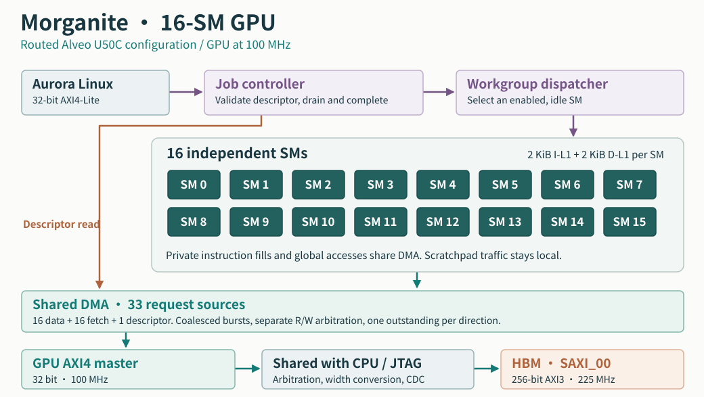
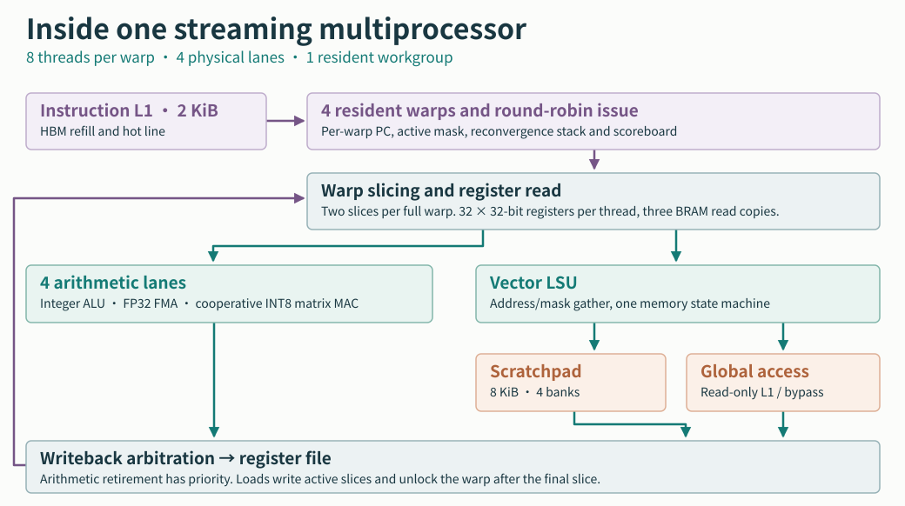
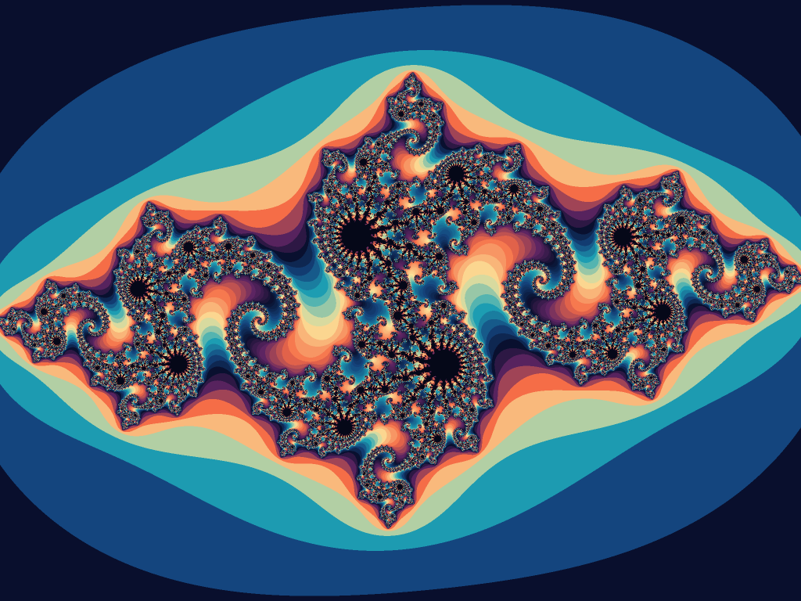
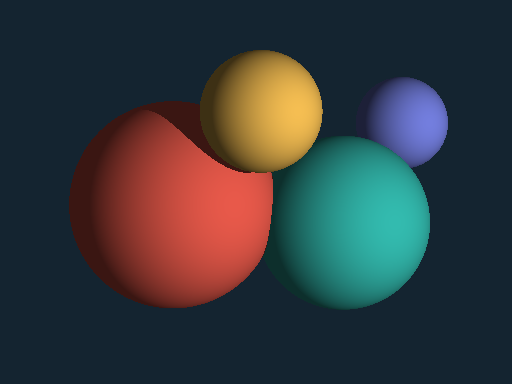
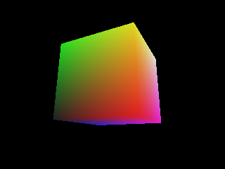

<p align="center"><a href="docs/u50c-16sm-20261124/images/mandelbrot.png"></a></p>

<p align="center"><a href="README.md">简体中文</a> · <strong>English</strong> &nbsp; | &nbsp; <a href="docs/README.en.md">Technical guides</a> · <a href="docs/u50c-16sm-20261124/README.en.md">Board report</a></p>

# Morganite programmable GPU

The cover is a framebuffer read back from an Alveo U50C. The Aurora out-of-order CPU boots LoongArch32 Linux and loads an assembled GPU program into HBM. Morganite’s 16 SMs evaluate four Mandelbrot samples per pixel and write RGBA8. The same bitstream runs ray tracing, N-body gravity, and independently replaceable vertex and fragment shaders.

## Architecture

[](docs/media/gpu-16sm.en.svg)

The controller dispatches one workgroup to each available SM. Sixteen instruction-fill ports, sixteen data ports and the descriptor reader share one DMA master.

[](docs/media/sm.en.svg)

Each eight-thread warp uses four physical lanes in two slices. Arithmetic and loads share register writeback. The 8 KiB scratchpad services local requests inside the SM.

## Board gallery

| Julia set · 1024×768 | Ray tracing · 512×384 | Indexed cube · 320×240 |
|:---:|:---:|:---:|
| [](docs/u50c-16sm-20261124/images/julia.png) | [](docs/u50c-16sm-20261124/images/raytrace.png) | [](docs/u50c-16sm-20261124/images/cube_a/color.png) |

## Measured on the U50C

| 16 SM, one bitstream | Measurement | Work measured |
| --- | ---: | --- |
| FP32 FMA | **11.583 GFLOPS** | Register-resident kernel, 90.49% of the 12.8 GFLOPS peak |
| INT8 matrix MAC | **23.122 GMAC/s** | Signed INT8 products and INT32 accumulation, 14.68× speedup from 1 to 16 SMs |
| Mandelbrot set | **928.51 ms** | Optimized program, full 1024×768 frame, four samples, up to 192 iterations |
| Ray tracing | **42.02 ms** | Optimized program, full 512×384 frame, four spheres and hard shadows |

Frame times sum all tiles using the 100 MHz device counter. The optimized programs also used a read-only submission window. Both full frames passed comparison. The optimized Julia run encountered a userspace fault, and the optimized N-body run has no complete board result. [Benchmarks and image errors](docs/u50c-16sm-20261124/README.en.md) · [Optimized run and counters](docs/u50c-16sm-opt-20261125/README.en.md)

## SoC data path

```text
CPU  ──┐
       ├────┐
JTAG ──┘    ├── AXI4 · 32 bit / 100 MHz ──→ 256 bit / 225 MHz ──→ HBM
GPU  ───────┘
CPU  ────────── AXI4-Lite · 32 bit ───────→ GPU
```

Reads and writes share one HBM AXI port. The CPU rings a doorbell over AXI4-Lite and polls the completion sequence. The GPU fetches descriptors, instructions and data. Each SM has four FP32 lanes, four resident eight-thread warps, 8 KiB of workgroup scratchpad, a 2 KiB instruction L1 and a 2 KiB read-only data L1. [CPU source](cpu/aurora) · [GPU source](src/main/scala/morganite) · [Linux driver and CLI](linux)

| Post-route resources | LUT | FF | BRAM tiles | DSP |
| --- | ---: | ---: | ---: | ---: |
| Aurora CPU | 105,660 | 40,087 | 61 | 8 |
| Morganite GPU | 300,491 | 136,926 | 256 | 576 |
| Complete SoC | 417,161 | 185,487 | 321.5 | 584 |

Vivado 2023.2 reported worst setup/hold slack of +0.062/+0.007 ns after routing. [Timing](docs/u50c-16sm-20261124/physical/timing_impl.rpt) · [Resources by SLR](docs/u50c-16sm-20261124/physical/resources.json)

## Getting started

1. **Run a GPU program.** Use the CLI on a booted Aurora Linux system to render the cube. [Shader ABI and scene format](docs/graphics.md)
2. **Write a kernel.** Start with the assembly examples, check results in the instruction model, then run the RTL in Verilator. [Examples](examples) · [ISA](docs/isa.md)
3. **Reproduce the hardware.** Use the WSL toolchain guide, frozen CPU, bitstream, Linux image and board archives. [Build and replay](docs/build.en.md) · [Two-SM release](docs/u50c-boot-20.en.md)

```sh
/bin/mgpu info
/bin/mgpu render /gpu/cube_a.scene /tmp/frame
```

[All technical guides](docs/README.en.md) · [Board gallery](docs/u50c-16sm-20261124/images/) · [RTL simulation gallery](docs/u50c-16sm-20261124/images/rtl)
