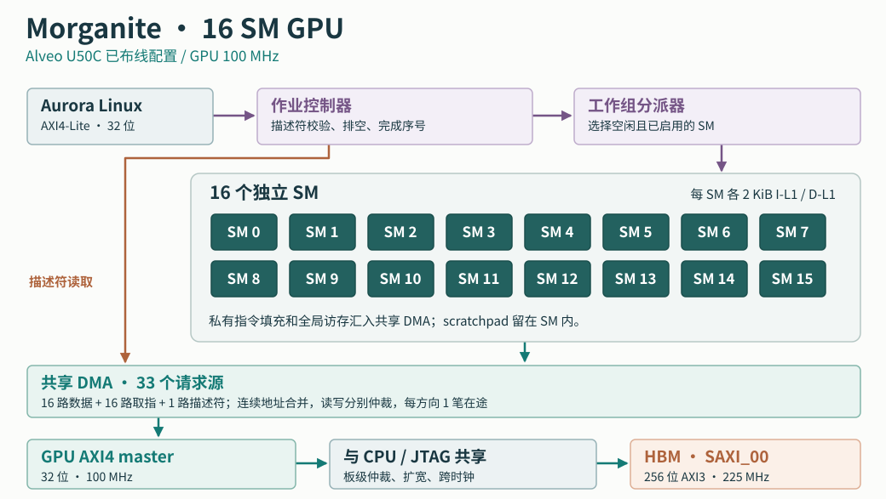
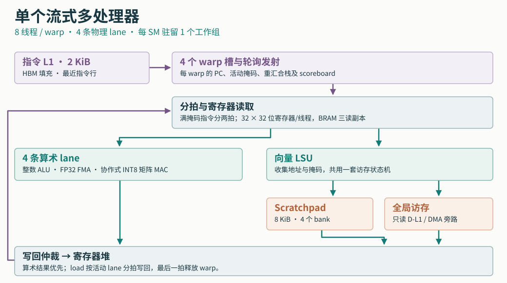
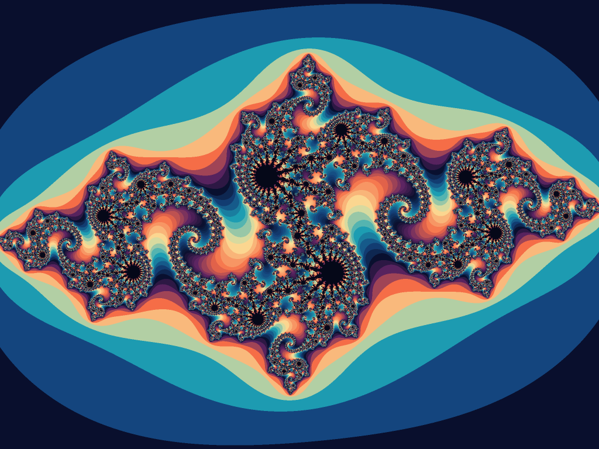
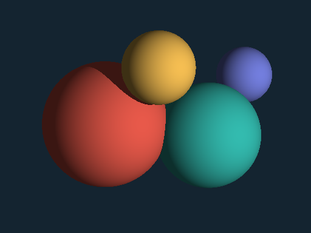
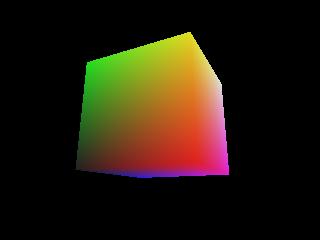

<p align="center"><a href="docs/u50c-16sm-20261124/images/mandelbrot.png"></a></p>

<p align="center"><strong>简体中文</strong> · <a href="README.en.md">English</a> &nbsp; | &nbsp; <a href="docs/README.md">技术文档</a> · <a href="docs/u50c-16sm-20261124/README.md">实板报告</a></p>

# Morganite 可编程 GPU

封面上的每个像素都来自 Alveo U50C。Aurora 乱序 CPU 启动 LoongArch32 Linux，将手写汇编生成的 GPU 程序装入 HBM。Morganite 的 16 个 SM 对每个像素取四个子样本，计算曼德博迭代并写回 RGBA8。换一段程序，同一份位流就能运行光线追踪、N 体引力，或执行可独立替换的顶点和片元着色器。

全图形版采用两个原生 256 位 HBM 主口。在同一份 4×4 SM 位流上，320×240 双立方体的 GPU 时间从 30.559 ms 降到 6.030 ms，寄存器驻留 FP32 内核达到 12.570 GFLOPS。[全图形版实板报告](docs/u50c-16sm-graphics-20261126/README.md) · [实板光追图](docs/u50c-16sm-graphics-20261126/board-01/final/paired/hardware/ray.png)

## 封面位流的硬件架构

[](docs/media/gpu-16sm.zh.svg)

分派器把工作组发给空闲 SM。16 路取指填充、16 路全局数据和作业描述符读取共用一个 DMA 主口。

[](docs/media/sm.zh.svg)

一个 8 线程 warp 由 4 条物理 lane 分两拍执行。算术和 load 共用寄存器写回端口，8 KiB scratchpad 在 SM 内服务本地访问。

## 实板图集

| 朱利亚集合 · 1024×768 | 球体光追 · 512×384 | 索引立方体 · 320×240 |
|:---:|:---:|:---:|
| [](docs/u50c-16sm-20261124/images/julia.png) | [](docs/u50c-16sm-20261124/images/raytrace.png) | [](docs/u50c-16sm-20261124/images/cube_a/color.png) |

## 封面位流的实板性能

| 同一份 16 SM 位流 | 实测结果 | 测量口径 |
| --- | ---: | --- |
| FP32 FMA | **11.583 GFLOPS** | 寄存器驻留，达到 12.8 GFLOPS 理论峰值的 90.49% |
| INT8 矩阵乘加 | **23.122 GMAC/s** | 有符号 INT8 乘法、INT32 累加；1→16 SM 加速 14.68× |
| 曼德博集合 | **928.51 ms** | 优化程序，1024×768 整帧，4 个子样本，最多 192 次迭代 |
| 球体光追 | **42.02 ms** | 优化程序，512×384 整帧，四个球体和硬阴影 |

帧时按 100 MHz GPU 作业计数器对所有图块求和。优化程序同时使用了只读提交窗口；两项整帧均通过图像对照。朱利亚续测遇到用户态故障，优化版 N 体尚无完整板测。 [基准与图像误差](docs/u50c-16sm-20261124/README.md) · [优化轮次与计数](docs/u50c-16sm-opt-20261125/README.md)

## 封面位流的 SoC 数据通路

```text
CPU  ──┐
       ├────┐
JTAG ──┘    ├── AXI4 · 32 bit / 100 MHz ──→ 256 bit / 225 MHz ──→ HBM
GPU  ───────┘
CPU  ────────── AXI4-Lite · 32 bit ───────→ GPU
```

读写经过同一个 HBM AXI 入口。CPU 用 AXI4-Lite 写 doorbell 并轮询完成序号，GPU 自行读取描述符、程序和数据。每个 SM 有 4 条 FP32 lane、4 个驻留 warp、8 KiB 工作组 scratchpad，以及各 2 KiB 的指令和只读数据 L1。 [CPU 源码](cpu/aurora) · [GPU 源码](src/main/scala/morganite) · [Linux 驱动与 CLI](linux)

| 布线后资源 | LUT | FF | BRAM tiles | DSP |
| --- | ---: | ---: | ---: | ---: |
| Aurora CPU | 105,660 | 40,087 | 61 | 8 |
| Morganite GPU | 300,491 | 136,926 | 256 | 576 |
| 完整 SoC | 417,161 | 185,487 | 321.5 | 584 |

Vivado 2023.2 布线后，最小 setup/hold 余量为 +0.062/+0.007 ns。 [时序](docs/u50c-16sm-20261124/physical/timing_impl.rpt) · [分 SLR 资源](docs/u50c-16sm-20261124/physical/resources.json)

## 从哪开始

1. **运行一个 GPU 程序.** 在已启动的 Aurora Linux 上使用下面的 CLI 渲染立方体。 [着色器与场景格式](docs/graphics.zh.md)
2. **修改内核.** 从汇编示例入手，用独立指令模型检查结果，再在 Verilator 中运行 RTL。 [示例](examples) · [ISA](docs/isa.zh.md)
3. **复现硬件.** WSL 工具链、冻结 CPU、位流、Linux 镜像和板测档案均有对应入口。 [构建与回滚](docs/build.md) · [双 SM 发布版](docs/u50c-boot-20.md)

```sh
/bin/mgpu info
/bin/mgpu render /gpu/cube_a.scene /tmp/frame
```

[完整技术文档](docs/README.md) · [实板图集](docs/u50c-16sm-20261124/images/) · [RTL 仿真图集](docs/u50c-16sm-20261124/images/rtl)
