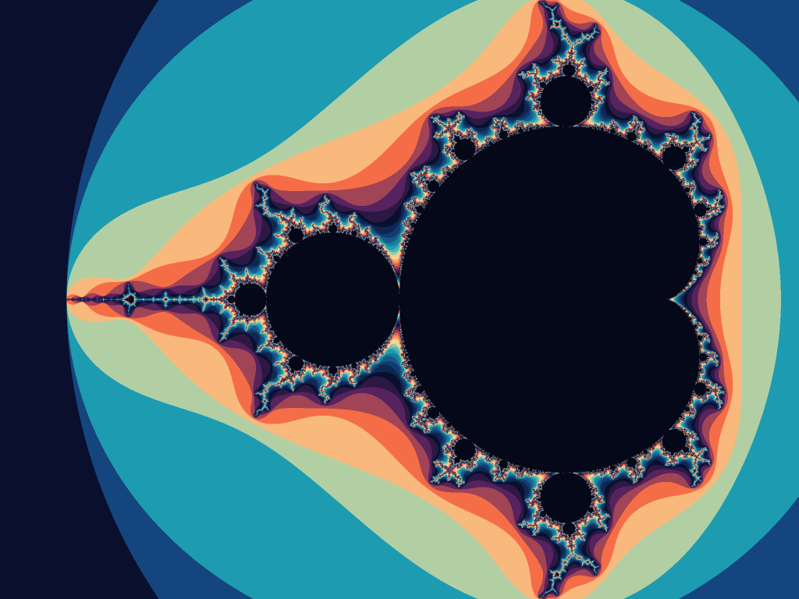
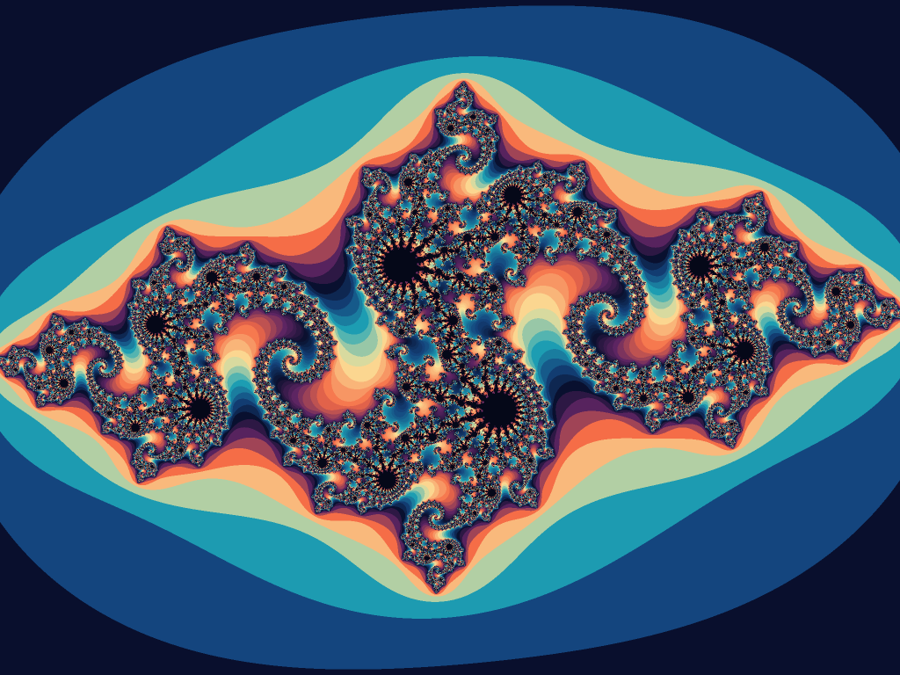
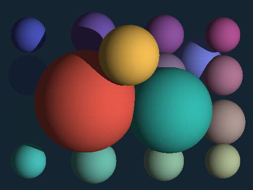
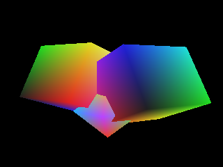

# 16-SM U50C board · Complex scenes and compute

[简体中文](README.md)

Aurora Linux detected the 4×4 SM grid after one JTAG reconfiguration. The HBM startup diagnostic, DMA loopback, both raster pipelines and four compute workloads passed. The GPU ran at 100 MHz with read-only data caching. The images are device-buffer readbacks transferred over UART and checked pixel by pixel in WSL. [BIT / LTX / Linux](../u50c-16sm-graphics-20261126/artifacts/) · [Source configuration](board/boot/build.json) · [Boot request](board/boot/request.json) · [GPU identification](board/uart-result.json) · [HBM / UART logs](board/logs.tar.gz)

| Mandelbrot | Julia |
|---|---|
| [](board/stress/mandelbrot.png) | [](board/stress/julia.png) |
| [](board/stress/raytrace.png) | [](board/scene/hardware/color.png) |

## Measured full-frame and four-step performance

| GPU program | Workload | 16-SM cycles | GPU time | Sum of Linux submit intervals | 1→16 SM |
|---|---|---:|---:|---:|---:|
| Mandelbrot | 1024×768 · 4 spp · 192 iter. | 87,923,558 | 879.236 ms | 888.833 ms | 15.97× |
| Julia | 1024×768 · 4 spp · 192 iter. | 85,718,198 | 857.182 ms | 863.947 ms | 15.95× |
| 20 spheres with shadows | 512×384 · 196,608 rays | 3,323,902 | 33.239 ms | 35.891 ms | 15.90× |
| N-body | 512 × 512 × 4 | 1,078,204 | 10.782 ms | 17.078 ms | 12.85× |

Each frame was rendered in 96-row strips. GPU time sums the counters for every 16-SM job in the frame. Linux submit time sums the submit-to-completion intervals. Image speedups compare the same central 96 rows on one and sixteen SMs. The N-body ratio covers all four steps. Each configuration ran once. UART readback, decompression and comparison use a separate host timer. [GPU jobs](board/jobs.json) · [Stress counters](board/stress/results.json) · [Timing summary](performance.json)

Both fractals matched the CPU reference byte for byte. Maximum ray-tracing channel error was 1. One and sixteen SMs produced byte-identical N-body states. The maximum absolute error against the double-precision integration rounded to FP32 was 1.19e-07.

The strip loops, including uploads, submission, UART readback and comparison, took 205.09 s for Mandelbrot, 292.27 s for Julia and 88.66 s for ray tracing. [CPU references](reference/)

## 320×240 · 32 triangles

Two cubes and an octahedron used 22 vertices and all 32 triangle-mask bits available in a draw. The programmable software pipeline took 41.489 ms and graphics instructions with workgroup culling took 9.390 ms, a 4.42× speedup. AXI reads fell from 12,075,712 B to 2,962,112 B. The complete Linux render commands took 1.938 s and 1.821 s, including uploads, initialization and saving all three buffers.

The two pipelines produced byte-identical outputs with 24,849 covered pixels and zero coverage or primitive-ID differences. The largest RGBA8 channel difference from the CPU reference was 1. Maximum absolute depth error was 1.79×10⁻⁷. The depth PNG stretches visible depths for display. The FP32 values are in depth.f32. [RGBA](board/scene/hardware/color.png) · [Depth](board/scene/hardware/depth.png) · [Comparison](board/scene/hardware/comparison.json)

This run also used the 16-SM Verilator model with two backpressured AXI memory ports. The RTL fractals used 256×192 at 64 iterations, the RTL ray tracer used 256×192, and raster and N-body used the same sizes as on the board. [Raster](scene32/rtl/render.json) · [Fractals](rtl-fractals-256x192/results.json) · [Rays](rtl-raytrace-20spheres/results.json) · [N-body](rtl-nbody512/results.json)

## Verification and replay

```bash
python3 scripts/stage_complex_scene.py build/complex-scene
python3 scripts/stage_stress.py build/complex-stress --dense-rays --tile-rows 96
python3 scripts/verify_complex_board.py docs/u50c-16sm-complex-20261127/board
(cd docs/u50c-16sm-complex-20261127 && sha256sum -c SHA256SUMS)
```

On the board VM, stage the linked BIT/LTX and Linux runtime, the host scripts from board/, and the generated complex-scene and complex-stress folders. start_test.py checks the hashes, programs the board, runs diagnostics and loads Linux.

```bash
python3 board/start_test.py "$BUILD_DIR" "$LINUX_DIR" boot
python3 board/uart_jobs.py boot
python3 board/uart_jobs.py boot --resume-run measured \
  --scene complex-scene/complex32.scene --stress-suite complex-stress --stress-readonly \
  --stress-case raytrace --stress-case nbody --stress-case mandelbrot --stress-case julia
```

This run reused the routed bitstream. Its implementation reports 105,316 LUTs for the CPU, 653,485 for the board-level GPU and 769,068 for the complete SoC. [LUT / FF / BRAM / URAM / DSP](../u50c-16sm-graphics-20261126/resources.json) · [Session](board/session.json)
