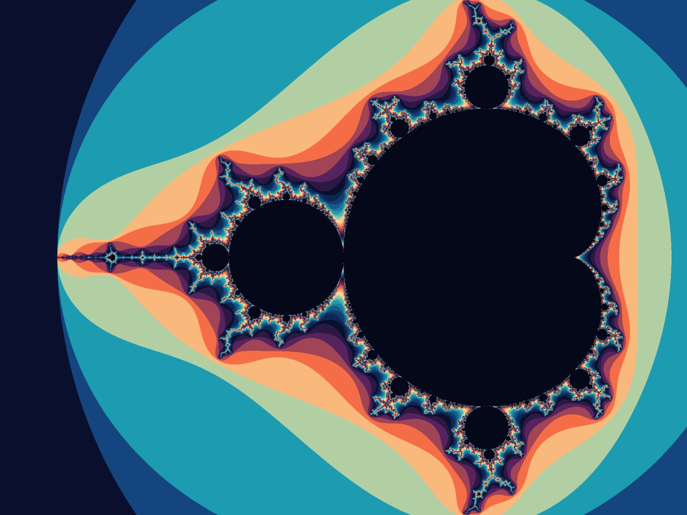
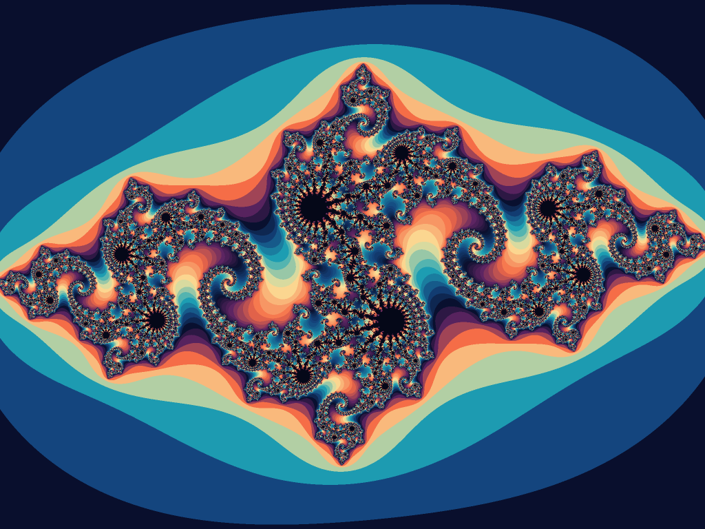
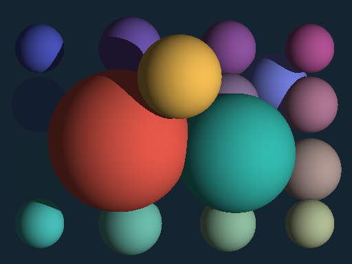
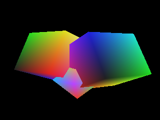

# 16 SM U50C 实板 · 复杂场景与计算

[English](README.en.md)

同一次 JTAG 编程后，Aurora Linux 识别 4×4 SM，完成 HBM 启动诊断、DMA 回环、两种光栅管线和四个计算负载。GPU 以 100 MHz 运行，启用了只读数据缓存。图像均取自设备缓冲，经串口回传并在 WSL 逐像素校验。 [BIT / LTX / Linux](../u50c-16sm-graphics-20261126/artifacts/) · [Source configuration](board/boot/build.json) · [Boot request](board/boot/request.json) · [GPU identification](board/uart-result.json) · [HBM / UART logs](board/logs.tar.gz)

| Mandelbrot | Julia |
|---|---|
| [](board/stress/mandelbrot.png) | [](board/stress/julia.png) |
| [](board/stress/raytrace.png) | [](board/scene/hardware/color.png) |

## 整帧与四步积分的实测性能

| GPU 程序 | 工作量 | 16 SM 周期 | GPU 时间 | Linux 提交时间之和 | 1→16 SM |
|---|---|---:|---:|---:|---:|
| Mandelbrot | 1024×768 · 4 spp · 192 iter. | 87,923,558 | 879.236 ms | 888.833 ms | 15.97× |
| Julia | 1024×768 · 4 spp · 192 iter. | 85,718,198 | 857.182 ms | 863.947 ms | 15.95× |
| 20 球阴影光追 | 512×384 · 196,608 rays | 3,323,902 | 33.239 ms | 35.891 ms | 15.90× |
| N-body | 512 × 512 × 4 | 1,078,204 | 10.782 ms | 17.078 ms | 12.85× |

每帧按 96 行分块。GPU 时间累加该帧所有 16 SM 作业计数，Linux 提交时间累加 CLI 的提交至完成区间。图像的 1→16 SM 比值只取同一帧中央 96 行，N-body 比值覆盖完整四步。每个配置采一次。串口下载、解压、比较在主机单独计时。 [GPU jobs](board/jobs.json) · [Stress counters](board/stress/results.json) · [Timing summary](performance.json)

两张分形图均逐字节匹配 CPU 参考。光追最大通道差为 1 级。N-body 的 1 SM 与 16 SM 最终状态逐字节一致，相对双精度积分后转 FP32 的最大绝对误差为 1.19e-07。

含逐块上传、提交、UART 回读和校验的墙钟时间分别为 Mandelbrot 205.09 s、Julia 292.27 s、光追 88.66 s。 [CPU references](reference/)

## 320×240 三维光栅场景

22 个顶点组成两个立方体和一个八面体，占满单次绘制的 32 个三角形掩码位。软件 SIMT 管线用了 41.489 ms，全图形指令加工作组剔除用了 9.390 ms，加速 4.42×。AXI 读取从 12,075,712 B 降至 2,962,112 B。Linux 整条渲染命令分别耗时 1.938 s 和 1.821 s，包含上传、初始化、三张缓冲回读和文件写出。

两种模式输出完全相同，覆盖 24,849 个像素，逐像素覆盖和图元编号错误为 0。最大 RGBA8 通道差 1，最大 FP32 深度绝对误差 1.79×10⁻⁷。深度 PNG 对可见像素的深度范围做了灰度拉伸，原始值在 depth.f32 中。 [RGBA](board/scene/hardware/color.png) · [Depth](board/scene/hardware/depth.png) · [Comparison](board/scene/hardware/comparison.json)

本轮 16 SM Verilator 使用带背压的双 AXI 内存模型。分形 RTL 为 256×192、64 次迭代，光追 RTL 为 256×192，光栅和 N-body 与相应实板工作量相同。 [Raster](scene32/rtl/render.json) · [Fractals](rtl-fractals-256x192/results.json) · [Rays](rtl-raytrace-20spheres/results.json) · [N-body](rtl-nbody512/results.json)

## 复查与复现

```bash
python3 scripts/stage_complex_scene.py build/complex-scene
python3 scripts/stage_stress.py build/complex-stress --dense-rays --tile-rows 96
python3 scripts/verify_complex_board.py docs/u50c-16sm-complex-20261127/board
(cd docs/u50c-16sm-complex-20261127 && sha256sum -c SHA256SUMS)
```

远端使用上述 BIT/LTX、镜像与运行时，先由 start_test.py 校验哈希、编程、自检、装载 Linux。在实板 VM 的新目录放入 board 下的主机 Python 脚本、complex-scene 和 complex-stress，再执行下列命令。

```bash
python3 board/start_test.py "$BUILD_DIR" "$LINUX_DIR" boot
python3 board/uart_jobs.py boot
python3 board/uart_jobs.py boot --resume-run measured \
  --scene complex-scene/complex32.scene --stress-suite complex-stress --stress-readonly \
  --stress-case raytrace --stress-case nbody --stress-case mandelbrot --stress-case julia
```

本轮复用已布线位流。原布线报告列出 CPU、GPU 板级模块及整 SoC 分别使用 105,316、653,485 和 769,068 个 LUT。 [LUT / FF / BRAM / URAM / DSP](../u50c-16sm-graphics-20261126/resources.json) · [Session](board/session.json)
