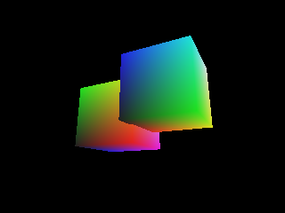
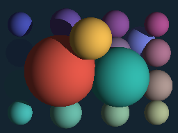
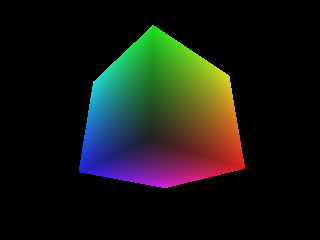

# U50C board validation and physical implementation of the 16-SM graphics SoC

[简体中文](README.md)

Aurora booted LoongArch32 Linux on this bitstream. The driver identified the 4×4 SM grid and all five graphics capabilities. The startup diagnostic passed two patterns across 16 HBM pseudo-channels, and Linux verified a GPU DMA loopback. [HBM log](board-01/hbm.log) · [Board request and image hashes](board-01/launch.json)

| Identical BIT, LTX and Linux image | Board manager run (UTC) | Verified scope |
| --- | --- | --- |
| First configuration | `20261126T155231.465942Z` | Linux shell, HBM, DMA, sequential jobs, full graphics and compute suite. [Result](board-01/final/uart-result.json) · [UART and raw buffers](board-01/final/linux-tests.tar.gz) |
| Second configuration | `20261126T163532.122307Z` | Reprogramming, peripheral and HBM diagnostics, image load, Linux shell, GPU identification and DMA loopback. [Result](board-02/uart-result.json) |
| Third configuration | `20261126T163928.989843Z` | Same checks as the second configuration. [Result](board-03/uart-result.json) |

Each run reconfigured the FPGA over JTAG and loaded 15,722,112 B of Linux image segments. Board power remained on. The remote debug session was closed after the third run. Archived test outputs and Vivado session logs were removed from the VM, and the retained bitstream, probe file and kernel image were hash-checked again. [Run IDs and cleanup record](board-session.json)

| Programmable workload | Software GPU program | GPU program with graphics instructions | GPU speedup |
| --- | ---: | ---: | ---: |
| Twin cubes, 24 triangles, 320×240 | 30.559 ms | 6.030 ms | 5.068× |
| Ray tracing with shadows, 20 spheres, 256×192 | 8.636 ms | 8.600 ms | 1.004× |

The cube pixel stage fell from 3,030,170 to 550,362 cycles. Whole-frame AXI reads fell from 6,912,032 B to 2,502,560 B, while writes changed from 925,440 B to 930,336 B. The ray kernel saved 3,613 cycles by accelerating part of the arithmetic. These counters come from one successful board measurement per variant.

| Rasterization with workgroup culling | 20-sphere ray tracing | Two cube viewpoints |
|:---:|:---:|:---:|
| [](board-01/retry/hardware/twin_cubes/color.png) | [](board-01/final/paired/hardware/ray.png) | [](board-01/final/frames/cube_b/color.png) |

All eight base scenes passed per-pixel comparison against the CPU reference. Coverage and winning triangle IDs matched exactly. The allowed RGBA8 difference is one quantization level per channel, and general depth tolerance is 2×10⁻⁶. Worst channel difference was one, and worst absolute depth error was 1.79×10⁻⁷. Depth matched exactly for shared edges, overlap and degenerate triangles. Replacing the vertex program changed coverage. Replacing only the fragment program changed color and preserved depth and winning IDs. [Frame comparisons](board-01/final/frames/comparisons.json) · [Board color and depth gallery](board-01/final/frames/)

Both cube runs produced identical color, depth and winning triangle IDs. All 13,907 covered pixels had the correct owner. All RGBA8 channels matched the independent CPU reference exactly, and the maximum absolute depth error was 1.19×10⁻⁷. The Linux render command took 1.932 s and 1.950 s respectively, including shader and input uploads, initialization, download and writing three buffers to files. GPU time sums the shader stage counters. The accelerated program uses both graphics instructions and workgroup culling. [Board color](board-01/retry/hardware/twin_cubes/color.png) · [Board depth](board-01/retry/hardware/twin_cubes/depth.png) · [Counters and CPU comparison](board-01/retry/raster.json)

Each ray kernel traced 49,152 primary rays and cast shadow rays for lit hits. Both frames stayed within one RGBA8 channel level of the independent CPU reference. Linux submission to completion took 10.451 ms and 10.199 ms, excluding scene upload and image download. The SFU variant changes square-root evaluation. Intersection, traversal and shadows still run on the SIMT lanes. [Board ray image](board-01/final/paired/hardware/ray.png) · [Counters](board-01/final/paired/results.json) · [Matching-size RTL](rtl/ray-256x192.json)

| Compute or memory workload | 16-SM board measurement | One active SM on the same bitstream |
| --- | ---: | ---: |
| 33,554,432 register-resident FP32 FMAs | 12.570 GFLOPS, 98.20% of peak | 15.946× speedup |
| 134,217,728 scalar INT8 MACs with INT32 accumulation | 25.139 GMAC/s or 50.278 GOPS | 15.945× speedup |
| 512-body gravity, four steps, 32 threads per group | 10.783 ms | 138.454 ms, 12.840× speedup |
| 64 pages of 4 KiB copied four times, 1 MiB each way | 1.023 GB/s each way | 0.077 GB/s each way |

The one-SM comparisons use a dispatch mask and identical work. N-body enabled the read-only L1 for each step's immutable input. Both masks produced byte-identical final states with a maximum absolute error of 1.19×10⁻⁷ against the CPU reference. The page-copy kernel moved 2.046 GB/s of aggregate useful traffic, reaching 16.0% of the dual-interface 6.4 GB/s ceiling in each direction. A separate short 8 KiB copy reached 530.9 MB/s counting reads and writes together. Both verified the output. Per-stack traffic was not measured on this board run. [Compute and short-copy counters](board-01/final/performance.json) · [Four N-body steps](board-01/final/stress/results.json) · [Page-copy counters and digest](board-01/final/page-copy.json)

The Linux suite checked every output word of 100 consecutive integer and FP32 AXPY jobs, then verified a buffer written by SM0 in one job and read by SM1 in the next. The CPU's private-memory check and a JTAG read/write to a separate address overlapped GPU sequence 129. [Concurrent access evidence](board-01/final/concurrent.json)

An isolated checkout at `e46aeee8333676544123c8a3f5f5155b6f2af58f` generated the complete 4×4 SM SoC. Each SM has four physical lanes, giving 64 GraphicsLane instances. The capability mask for triangle setup, binning, raster, ROP and SFU is `0x1f`. The SFU supports approximate FP32 reciprocal and reciprocal square root. The CPU and GPU target 100 MHz. Two native 256-bit GPU AXI4 ports connect to the 225 MHz HBM interface. [Configuration and hashes](inputs.json)

| Subsystem | Build configuration |
| --- | --- |
| Compute | Each SM holds four eight-thread warps and issues a full warp across four physical lanes in two beats. Up to 512 threads can reside on the GPU. The lanes support FP32 FMA and signed INT8 matrix multiply-accumulate. Four lanes produce a 2×2 output tile with K=4 and 32-bit accumulators. |
| Registers and on-chip memory | Each thread has 32 registers of 32 bits. The BRAM register-file and early-branch options are enabled. Each SM has 8 KiB of scratchpad, a 2 KiB instruction L1 and a 2 KiB read-only data L1. Lines are 32 bytes. Only a designated immutable range is cacheable. Writes bypass the data L1. |
| Memory access | Each SM has two global LSU slots and two data L1 miss entries. Four clusters of four SMs feed a tree NoC. Each GPU port supports eight outstanding reads and four outstanding writes. The DMA window is striped across the stacks in 4 KiB pages. The GPU uses HBM SAXI01 and SAXI17, the CPU and JTAG share SAXI00, and the GPU control port uses 32-bit AXI4-Lite. |
| Graphics | Programs issue instructions for triangle edge coefficients and top-left bias, 8×8-pixel binning, edge evaluation and coverage, FP32 depth comparison, RGBA8 alpha blending, and approximate reciprocal and reciprocal square root. Programs control primitive traversal and framebuffer writes. |

At 100 MHz the 64 lanes can deliver **12.8 GFLOPS** if every lane accepts an FP32 FMA every cycle. The two 256-bit masters together can transfer **6.4 GB/s** in one direction at full utilization. A same-port write followed by a read returned all X in the vendor HBM simulation. [Pin-level trace](../16sm-wide-hbm-rtl-20261126/pin-handshakes.txt)

The Vivado 2023.2 build started at 19:08:59 UTC+8 on 2026-11-26 in `/home/fpga/morganite-16sm-graphics-e46aeee-qQitZVZs`, targeting `xcu50-fsvh2104-2-e`. CPU and GPU RTL hashes were verified after transfer. The previous timing build was stopped during rip-up and reroute with its opt, placed and physopt checkpoints retained. [Run status](status.json) · [Previous run stop record](previous-build-stopped.json)

Generate the upload package from a clean checkout of that revision. Run the second command from the package directory on the Vivado 2023.2 build host.

```bash
python3 scripts/stage_soc.py build/soc-gfx --grid 4x4 --wide-ports 2 --accelerators --units setup bins raster rop sfu
bash run_soc.sh
```

## Synthesis

| Hierarchy | LUT | FF | BRAM tile | URAM | DSP |
| --- | ---: | ---: | ---: | ---: | ---: |
| Aurora CPU | 112,056 | 40,080 | 61 | 0 | 8 |
| Morganite GPU | 712,789 | 290,794 | 254 | 0 | 1,856 |
| SoC | 836,769 | 343,496 | 321.5 | 0 | 1,864 |

The 64 GraphicsLane instances account for 43,152 LUTs, 64,640 FFs and 1,280 DSPs within the GPU row. Synthesized SoC LUT utilization is 95.99%. [Vivado synthesis reports](synthesis.tar.gz) · [Hierarchy totals](synthesis.json)

Of the GPU core LUTs, the 16 SM instances use 388,364 (54.5%), the wide DMA and arbitration use 206,503 (29.0%), and the 16 data L1 instances with their control logic use 116,194 (16.3%). The GPU top level and control-port queues account for the remaining 1,728. The SM counts include the graphics lanes.

## Placement

Placement finished at 20:49:22 UTC+8 and routing began at 20:52:31. Vivado estimated +0.550 ns of worst setup slack after placement. The synthesis table above gives CPU and GPU resource counts. The following figures cover the placed SoC and its two SLRs. [Vivado placement report](utilization-placed.rpt)

| Region | LUT | LUT utilization | FF | BRAM tiles | URAM | DSP |
| --- | ---: | ---: | ---: | ---: | ---: | ---: |
| SLR0 | 380,942 | 86.64% | 180,240 | 148.5 | 0 | 1,044 |
| SLR1 | 388,126 | 89.84% | 163,715 | 173 | 0 | 820 |
| SoC | 769,068 | 88.23% | 343,955 | 321.5 | 0 | 1,864 |

## Final bitstream and physical results

Vivado wrote the bitstream at 23:13:41 UTC+8 on November 26, 2026. The build exited with code 0 at 23:31. These post-route totals come from `hierarchy_impl.rpt`. The GPU board wrapper includes the GPU core.

| Post-route hierarchy | LUTs | FFs | BRAM tiles | URAMs | DSPs |
| --- | ---: | ---: | ---: | ---: | ---: |
| Aurora CPU (`u_cpu`) | 105,316 | 40,075 | 61 | 0 | 8 |
| Morganite GPU core (`u_gpu_soc/gpu`) | 651,988 | 290,910 | 254 | 0 | 1,856 |
| GPU with board interfaces (`u_gpu_soc`) | 653,485 | 291,019 | 254 | 0 | 1,856 |
| Full SoC | 769,068 | 343,955 | 321.5 | 0 | 1,864 |
| Frozen CPU-only SoC (`5ec35882`) | 112,771 | 48,279 | 65.5 | 0 | 8 |

All 1,068,825 routable nets were routed, with zero routing errors. Worst setup/hold slack was +0.100/+0.010 ns. TNS, THS and failing pulse-width endpoints were zero. The table gives intra-clock slack. The archive includes inter-clock timing. [Frozen baseline reports](../../baseline/rollback/remote-evidence.tar.gz) · [Implementation reports](implementation.tar.gz)

| Clock domain | Baseline setup / hold (ns) | This build setup / hold (ns) |
| --- | ---: | ---: |
| CPU/GPU 100 MHz | +1.838 / +0.010 | +0.100 / +0.010 |
| HBM AXI 225 MHz | +1.213 / +0.019 | +0.648 / +0.010 |
| Board reference sysclk3 | +6.486 / +0.010 | +4.376 / +0.013 |
| Debug TCK | +11.673 / +0.019 | +11.247 / +0.010 |

DRC reported 5,281 warnings, including 5,272 DSP pipeline warnings, eight LUT equation warnings and one net without routable loads. DRC errors and critical warnings were zero. The CDC summary classified all 166 endpoints as safe. The constraint check reported zero unconstrained internal endpoints and a missing output delay on the board pin `HBM_CATTRIP`. The separate methodology report includes TIMING-9. See `exceptions_impl.rpt` and `methodology_impl.rpt` in the implementation archive for clocks, exceptions and affected cells.

Vivado estimated **26.755 W** total on-chip power, including 16.847 W for the FPGA and 9.908 W for HBM, with medium confidence. Estimated rail current exceeded the reported budget on Vccint_io (7.445 A of 7.380 A), VCC_IO_HBM (4.584 A of 3.840 A) and VCC_HBM (4.919 A of 4.160 A). The VM provides no board current telemetry. Physical board power and rail currents were unmeasured.

Run `sha256sum -c SHA256SUMS` to verify the local artifacts. The uncompressed bitstream hashes to `fe12b419b028d031f5a61e4f3c7f8c7b688399a73a744d613905cdb5c1e192bd` and the matching LTX hashes to `2cc13d4e7a8ff29d4df5feb449363702a3971c4a03c4fe0facfb57c8d87025bc`. Chisel elaboration runs locally. The FPGA build server receives generated Verilog/SystemVerilog, board glue, Tcl/XDC, board definitions and build manifests. [Bitstream](artifacts/u50c_top.bit.gz) · [Debug probes](artifacts/u50c_top.ltx) · [Actual build input package](artifacts/soc-inputs.tar.gz)

## Linux driver and programmable workloads

MG_STATE reads one MMIO register per poll. The CLI reads the final sequence, fault and counters on completion and falls back to the original ioctl on older drivers. Each stage gives the read-only data L1 its immutable inputs. These include parameters and vertices, transformed vertices and indices, triangle bounds, or setup records and tile masks. All stage outputs are outside their respective read-only window. The pixel shader unrolls four tile-mask reads and uses their union to skip a 128-byte triangle record and two barriers whenever a whole workgroup misses it.

Two 320×240 runs on the same 16-SM Verilator model rendered 24 triangles with the read-only L1 enabled. Color, depth and winning triangle IDs matched bit-for-bit between runs. Both covered 13,907 pixels and their maximum absolute depth error against the CPU reference was 1.19×10⁻⁷. Times are GPU cycles converted at 100 MHz. The two AXI ports use a backpressured memory model. [Stage counters](rtl/raster.json) · [Color](rtl/twin-cubes.png) · [Depth preview](rtl/twin-cubes-depth.png)

| Scene and pipeline | GPU cycles | Time at 100 MHz | Total 32-byte read beats |
| --- | ---: | ---: | ---: |
| Twin cubes, software shaders | 2,947,199 | 29.472 ms | 215,971 |
| Twin cubes, graphics instructions and workgroup culling | 551,029 | 5.510 ms | 78,088 |

This was a **5.35×** speedup with **63.8%** fewer read beats. A separate 64×32 run with data L1 bypassed used 103,327 cycles in software, 113,675 cycles with graphics instructions and a full triangle traversal, and 66,572 cycles with workgroup culling.

The 128×96 ray test traces 12,288 primary rays against 20 spheres and casts shadows for lit hits. With identical sphere tables and output layouts, software square root took 220,616 cycles (2.206 ms) and the SFU with one Newton refinement took 219,395 cycles (2.194 ms), a **1.006×** speedup. Each had a maximum RGBA8 channel error of one against the double-precision CPU reference. [Ray-traced frame](rtl/ray.png) · [Ray counters](rtl/ray.json)

The board package contains a 256×192 ray test and reference pixels. The Linux image SHA-256 is `37843c6c4f759ec99d05045363a449771b282b65f07fdc099fedf768ff0f72b0`. Its BSS zero range is `[0x01200000, 0x0127c2c8)`. The live shell verified the CLI and GPU program hashes. The driver allocated a 2 MiB coherent DMA buffer at device address `0x01c00000`. [Linux image, driver and GPU programs](artifacts/linux-board.tar.gz) · [DMA evidence](board-01/dma-mapping.json)

```bash
bash linux/build_userspace.sh --units setup bins raster rop sfu --software-assets
python3 linux/build_kernel.py --feature-register --graphics-registers --initramfs-compression none
python3 scripts/stage_software.py build/linux-gfx --sms 16 --gpu-features 0x403
```

On the VM, extract the host runner package in the software directory. Link `runner/gpu` and `runner/references` to `../gpu` and `../references`. Run `python3 start_test.py <build-directory> . output`, then `python3 runner/uart_jobs.py output --paired-graphics --stress-suite nbody-suite --stress-case nbody --stress-readonly --page-copy --full`. The first depth readback failed its UART gzip CRC. The runner now verifies SHA-256 per chunk and per file. The minimal initramfs lacked `/dev/zero`, so the runner created the node using the device number verified against sysfs and resumed on the same boot. [Host scripts and N-body inputs](artifacts/board-runner.tar.gz) · [First transfer log](board-01/suite.log) · [Retry log](board-01/retry/suite.log)

The archived workload sources and reference generator match the per-file software manifest from the tested tree. The earlier twin-cube retry scripts are available separately. [Workload source snapshot](artifacts/workload-sources.tar.gz) · [Twin-cube retry scripts](artifacts/uart-raster-retry.tar.gz)

The worst setup path crosses SLR0 to SLR1 from a GPU descriptor register to the DMA segment request state machine, with 12 logic levels and 9.395 ns of data-path delay. The worst hold path is inside the AXI4-to-AXI3 write address queue of the HBM bridge. CPU, GPU and full-SoC per-SLR counts come from the same checkpoint. [Timing endpoints and constraints](implementation.json) · [Resources by SLR](resources.json)

The register-resident RTL benchmark uses 16 groups of 32 threads, 16 accumulators and a loop unrolled 16 times. At an assumed 100 MHz, FP32 delivers 0.788 GFLOPS on one SM and **12.513 GFLOPS** on 16 SMs (97.76% of peak), with a 15.87× speedup on identical work. INT8 K=4 reaches **50.051 GOPS** on 16 SMs, counting two operations per scalar MAC. A 512-body N-body step took 247,957 cycles, with a maximum absolute error of 1.12×10⁻⁸. The older harness launched the 32-thread tiled kernel with 16 threads and failed the reference comparison. The 32-thread run passed. [Compute counters and output checks](rtl/compute.json)

Remote cleanup removed 9,139 files and released 12.63 GiB. SHA-256 hashes matched before and after for all 371 retained files checked. The final scan covered 12 project directories including the new Linux payload, retained archives and upload fragments. [Cleanup totals and retained artifact hashes](remote-cleanup.json)
